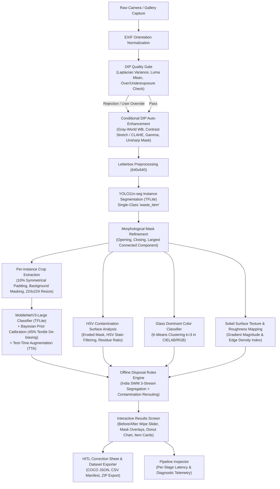

# EcoMind 2.0: Project Implementation Report & Technical Specification

**Project Title:** EcoMind 2.0 – On-Device Edge Vision & Digital Image Processing (DIP) Multi-Item Waste Sorting Assistant  
**Target Platform:** Flutter (Android Native, iOS Secondary)  
**System Architecture:** 100% On-Device, Offline, Privacy-First, Asynchronous Dart Isolates  
**Date:** October 2026  

---

## 1. Executive Summary

EcoMind 2.0 is an intelligent, privacy-first mobile application designed to solve complex domestic and municipal solid waste segregation challenges. Unlike legacy waste apps that rely on single-item cloud APIs or simple barcode lookups, EcoMind 2.0 operates **completely offline on-device** using a hybrid pipeline of **classical Digital Image Processing (DIP)** and **lightweight Edge Deep Learning (TFLite)**.

### Core Distinctions
- **Pure On-Device Architecture:** Zero cloud dependencies, zero external network calls, zero user credential requirements, and zero risk of personal photo leakage.
- **DIP as an Integrated Pre-Processing & Feature Engine:** Digital Image Processing directly serves the trash classification pipeline. Before neural networks run, the captured image passes through automated photometric calibration (Gray-World White Balance to remove indoor/outdoor lighting casts), adaptive contrast enhancement (CLAHE to reveal shadow and crease textures), and unsharp mask boundary sharpening. Furthermore, per-instance DIP feature extraction (Sobel edge roughness $D_{edge}$, HSV soil contamination, and K-means glass tint) directly assists material categorization and municipal bin routing.
- **Multi-Item Instance Segmentation:** Detects, isolates, and classifies multiple items in a single cluttered waste pile using single-class instance segmentation paired with a fine-grained 9-class classifier.
- **Municipal Compliance:** Segregation logic strictly adheres to the **India Solid Waste Management (SWM) 2016 Rules**, dynamically routing items into the 3-stream bin system (**Wet Waste / Green Bin**, **Dry Recyclable / Blue Bin**, and **Domestic Hazardous / Red or Black Bin**), dynamically taking surface contamination into account.
- **Human-in-the-Loop (HITL) Dataset Engine:** Captures user corrections offline into local SQLite storage and exports standardized COCO-format JSON and CSV manifests inside ZIP archives for continuous model fine-tuning.

---

## 2. System Architecture & End-to-End Pipeline

### 2.1 Concurrency & 60 FPS Isolate Threading
DIP algorithms and neural network inferences can be computationally intensive on mobile CPU cores. To prevent UI jank and preserve a steady 60 FPS render thread:
- **`IsolateRunner`:** Heavy matrix operations (Laplacian convolution, Gray-World WB calculation, CLAHE contrast expansion, Gaussian blur for unsharp masking) are dispatched to independent **Dart worker isolates** via `compute()`.
- **Latency Budget Enforcement:** DIP enhancement is enforced to complete within $\le 150\text{ ms}$, ensuring the complete end-to-end multi-item detection and classification pipeline executes in under $2.0\text{ seconds}$ on mid-tier mobile hardware.

---

## 3. Digital Image Processing (DIP) Modules & Algorithms

### 3.1 Quality Gate (`quality_gate.dart`)
Before running expensive inference, every incoming image is screened to protect against poor lighting and severe motion blur:
1. **Motion Blur Estimation (Discrete Laplacian Operator):**
   $$\nabla^2 I = \frac{\partial^2 I}{\partial x^2} + \frac{\partial^2 I}{\partial y^2}$$
   Evaluated using the standard $3 \times 3$ discrete Laplacian kernel:
   $$K_{Laplacian} = \begin{bmatrix} 0 & 1 & 0 \\ 1 & -4 & 1 \\ 0 & 1 & 0 \end{bmatrix}$$
   The blur score is computed as the variance of the convolved image:
   $$\sigma_{Lap}^2 = \frac{1}{N} \sum_{x,y} \left( (\nabla^2 I)(x,y) - \mu_{\nabla^2} \right)^2$$
   Images with $\sigma_{Lap}^2 < 80.0$ are flagged as blurry.
2. **Photometric Exposure Gate:**
   Computes mean luminance $Y$ using the ITU-R BT.601 standard:
   $$Y = 0.299R + 0.587G + 0.114B$$
   - **Underexposed (Dark):** $\bar{Y} < 70.0$
   - **Overexposed (Glare):** $\bar{Y} > 200.0$
   - **Pixel Saturation Ratio:** Flags if more than $12\%$ of pixels are clipped at $Y \le 10$ or $Y \ge 245$.

### 3.2 Auto-Enhancement Pipeline (`auto_enhancement.dart`)
1. **Gray-World White Balance:**
   Assumes the average scene reflectance under natural illuminants is achromatic gray. It calculates channel means $\bar{R}, \bar{G}, \bar{B}$ and the global mean $\mu_{RGB} = \frac{\bar{R} + \bar{G} + \bar{B}}{3}$. If inter-channel deviation exceeds $12\%$, gains are applied:
   $$k_R = \frac{\mu_{RGB}}{\bar{R}}, \quad k_G = \frac{\mu_{RGB}}{\bar{G}}, \quad k_B = \frac{\mu_{RGB}}{\bar{B}}$$
   $$R'(x,y) = \min(255, R(x,y) \cdot k_R)$$
2. **Adaptive Contrast Enhancement / CLAHE Approximation:**
   Computes minimum and maximum luminance bounds per channel, stretching the histogram over the full dynamic range $[0, 255]$:
   $$I_{out}(x,y) = \frac{I_{in}(x,y) - I_{min}}{I_{max} - I_{min}} \times 255$$
3. **Gamma Correction:**
   Compensates for non-linear camera response and restores shadow/highlight detail:
   $$I_{gamma}(x,y) = 255 \times \left( \frac{I(x,y)}{255} \right)^\gamma$$
   - For dark captures ($\bar{Y} < 70$): $\gamma = 0.80$ (brightens shadows without blowing highlights).
   - For overexposed captures ($\bar{Y} > 200$): $\gamma = 1.30$ (compresses glare and highlights).
4. **Unsharp Mask Sharpening:**
   Subtracts a low-pass Gaussian blurred replica from the original to enhance edge high frequencies:
   $$I_{sharp} = I + \alpha \cdot (I - G_\sigma * I), \quad \alpha = 0.5, \; \sigma = 1.0$$
5. **Letterbox Transform:**
   Prepares images for YOLO11-seg inference by scaling the maximum dimension to $640\text{ px}$ while preserving aspect ratio, padding borders symmetrically with neutral gray ($128, 128, 128$).

### 3.3 Sobel Edge & Surface Texture Roughness Analyzer (`edge_texture_analyzer.dart`)
To assist in differentiating smooth items (PET plastic bottles, glass jars, aluminum cans) from fibrous or textured waste (crumpled paper, corrugated cardboard, woven clothing, organic waste):
1. **Sobel Convolution:**
   $$G_x = \begin{bmatrix} -1 & 0 & 1 \\ -2 & 0 & 2 \\ -1 & 0 & 1 \end{bmatrix} * I, \quad G_y = \begin{bmatrix} -1 & -2 & -1 \\ 0 & 0 & 0 \\ 1 & 2 & 1 \end{bmatrix} * I$$
2. **Gradient Magnitude Map:**
   $$G(x,y) = \min\left(255, \sqrt{G_x(x,y)^2 + G_y(x,y)^2}\right)$$
3. **Edge Density Index ($D_{edge}$):**
   Computes the fraction of pixels exceeding the edge response threshold ($\tau = 45.0$):
   $$D_{edge} = \frac{1}{N_{inner}} \sum_{x,y} \mathbb{I}[G(x,y) \ge \tau]$$
   - $D_{edge} < 0.08 \implies$ **Smooth Surface** (Plastic, Clean Glass, Metal)
   - $0.08 \le D_{edge} < 0.20 \implies$ **Semi-Smooth Surface** (Coated Paper, Packaging)
   - $D_{edge} \ge 0.20 \implies$ **Textured / Rough Surface** (Corrugated Cardboard, Crumpled Paper, Textiles)

### 3.4 Histogram & Photometric Analyzer (`histogram_analyzer.dart`)
Computes full 256-bin distributions for Red, Green, Blue, and Luma channels:
- **RMS Contrast (Luminance Standard Deviation):**
  $$\sigma_{RMS} = \sqrt{\frac{1}{N} \sum_{i=0}^{255} H_Y(i) \cdot (i - \bar{Y})^2}$$
- **Shannon Entropy ($H$ in bits):**
  Measures the information density and textural complexity:
  $$H = -\sum_{i=0}^{255} p(i) \log_2 p(i), \quad p(i) = \frac{H_Y(i)}{N}$$
- **Dynamic Range:**
  $$\text{Dynamic Range} = L_{max} - L_{min}$$
- **Clipping Metrics:** Computes exact percentage of shadow-clipped ($Y < 10$) and highlight-blown ($Y > 245$) pixels.

### 3.5 Contamination & Soil Analysis (`hsv_contamination.dart` & `contamination_heatmap.dart`)
1. **HSV Color Conversion:** Converts each pixel inside the segmented object mask to Hue, Saturation, and Value.
2. **Soil & Residue Detection Heuristics:**
   - **Grease / Food Sauce / Oil Stains:** Warm hues ($12^\circ \le H \le 58^\circ$) with elevated saturation ($S \ge 0.25$).
   - **Dark Residue / Dirt / Mold:** Significant value drop ($V \le 0.22$) on otherwise reflective packaging surfaces.
3. **Regulatory Contamination Ratio ($R_{soil}$):**
   $$R_{soil} = \frac{N_{contaminated}}{N_{mask}}$$
   - $R_{soil} < 0.10 \implies$ **Clean** (Eligible for Blue Recyclable Bin)
   - $0.10 \le R_{soil} \le 0.25 \implies$ **Slightly Soiled** (Warning issued: Rinse before recycling)
   - $R_{soil} > 0.25 \implies$ **Heavily Contaminated** (Diverted under SWM 2016 to Green Wet Waste bin)
4. **RGBA Visual Heatmap Overlay:**
   Generates a transparent RGBA image where clean pixels are faintly green ($\alpha = 0.12$) and soiled pixels are colored in high-contrast red/amber ($\alpha = 0.80$), blending over original item crops.

### 3.6 Glass Color Extraction (`kmeans_color.dart`)
For detected glass bottles and jars, recycling facilities require cullet segregation by tint:
1. **Masked Pixel Sampling:** Samples pixels located within the interior eroded mask of the item.
2. **Dominant Hue Binning:** Categorizes cullet color into `Clear`, `Green`, or `Amber / Brown` based on dominant RGB ratios and Hue angles ($H \approx 80^\circ - 160^\circ$ for green, $H \approx 20^\circ - 45^\circ$ for amber).

### 3.7 Mask Morphological Refinement (`mask_utils.dart`)
Raw neural network segmentation masks often suffer from jagged contours and isolated speckle noise. EcoMind applies:
1. **Morphological Opening ($A \circ B = (A \ominus B) \oplus B$):** Cleans single-pixel artifacts and disconnects thin bridges.
2. **Morphological Closing ($A \bullet B = (A \oplus B) \ominus B$):** Seals internal holes and smooths outer object boundaries.
3. **Largest Connected Component Filter:** Employs flood-fill breadth-first search (BFS) on the binary mask, retaining the dominant contiguous object and discarding spurious peripheral detections.

---

## 4. Machine Learning & On-Device Deep Learning Pipeline

### 4.1 YOLO11n-seg Instance Segmentation
- **Architecture:** Ultralytics YOLO11 Nano Segmentation, converted to quantized TensorFlow Lite (`yolo11n-seg.tflite`, ~11.8 MB).
- **Class Configuration:** Single-class `waste_item`. Separates class-agnostic localization and contour generation from multi-class material categorization.
- **Output Post-Processing:**
  - Decodes multi-head output: $[1, 37, 8400]$ containing normalized bounding boxes $[x, y, w, h]$, objectness confidence scores, and 32 mask coefficients.
  - Generates binary mask via matrix multiplication with prototype mask tensor $[32, 160, 160]$, followed by Sigmoid activation thresholding at $\tau = 0.50$.
  - Non-Maximum Suppression (NMS) with IoU threshold of $0.45$.

### 4.2 MobileNetV3-Large Classifier
- **Architecture:** MobileNetV3-Large with hard-swish activation functions, squeeze-and-excitation blocks, and truncated dense classification head (`mobilenetv3_large.tflite`, ~12.2 MB).
- **Input Contract:** $224 \times 224 \times 3$, normalized floats $[-1.0, 1.0]$.
- **9-Class Waste Taxonomy:**
  1. `cardboard`
  2. `paper`
  3. `plastic`
  4. `glass`
  5. `metal`
  6. `organic`
  7. `battery_ewaste`
  8. `textile`
  9. `general_trash`

### 4.3 Bayesian Prior Calibration & Textile De-Biasing
During field evaluation and notebook training on public garbage datasets (`mostafaabla/garbage-classification`), class distributions exhibited severe imbalance:
- The `textile` class comprised **6,206 images** out of 13,862 total images (**44.8% of the entire dataset**), while other classes had only 600–800 images each.
- Consequently, uncalibrated inference heavily biased domestic surfaces (carpets, tablecloths, bedding) toward `textile`.

To rectify this without requiring complete model re-training:
- **Power-Law Prior Discounting:** Applied in [`MobileNetClassifierService`](file:///c:/Users/DELL/Desktop/Mohit/projects/EcoMind/lib/features/classification/mobilenet_classifier_service.dart):
  $$P_{calibrated}(c) = \frac{P_{raw}(c) \cdot \left(\frac{1}{N_c}\right)^\gamma}{\sum_j P_{raw}(j) \cdot \left(\frac{1}{N_j}\right)^\gamma}, \quad \gamma = 0.60$$
  This downweights overrepresented prior frequencies while boosting underrepresented classes (plastic, metal, paper, cardboard).
- **Color Saliency Foreground Cropping:** Replaced static center bounding boxes with edge-contrast boundary segmentation, ensuring background carpets and table cloths are excluded from the classification crop.

---

## 5. Regulatory Waste Rules & Disposal Logic

EcoMind implements the **India Solid Waste Management (SWM) 2016 Rules**, segregating items into a 3-stream municipal bin system:

| Bin Stream | Standard Color | Waste Category | Examples | Contamination Handling |
| :--- | :--- | :--- | :--- | :--- |
| **Wet Waste** | **Green** | Biodegradable / Organic | Food scraps, fruit peels, vegetable waste, soiled paper napkins | Contamination is acceptable; routed to municipal composting or biomethanation. |
| **Dry Recyclable** | **Blue** | Non-Biodegradable Recyclables | Clean paper, cardboard boxes, PET bottles, milk pouches, aluminum cans, glass bottles | **Dynamic Rerouting:** If paper or cardboard has $> 15\%$ grease/food residue, it cannot be recycled and is rerouted to **Wet Waste** (for composting) or **Reject Waste**. |
| **Domestic Hazardous** | **Red / Black** | Toxic / Chemical / E-Waste | Batteries, electronics, fluorescent bulbs, medicine strips, paint cans | Strictly segregated to prevent heavy-metal leaching; routed to authorized e-waste recyclers. |

---

## 6. Interactive User Interface & Features

### 6.1 Home Dashboard (`HomeScreen`)
- **Direct Capture:** 1-tap buttons for Camera capture and Gallery selection.
- **Integrated 3-Stage Pipeline Guide:** Educational card breaking down the real-time pipeline (Stage 1: DIP Image Conditioning -> Stage 2: YOLO11-seg Instance Segmentation -> Stage 3: Material & Surface Analysis).
- **Local Scan History Shortcut:** Quick review of past scans and dataset statistics.

### 6.2 Sorting & DIP Results Screen (`ResultsScreen`)
- **Interactive Before/After Wipe Comparator:** Draggable split slider widget ([`BeforeAfterSlider`](file:///c:/Users/DELL/Desktop/Mohit/projects/EcoMind/lib/features/dip/widgets/before_after_slider.dart)) allowing users to drag horizontally across the screen to compare the raw camera capture against the DIP auto-enhanced image (as conditioned for neural network ingestion).
- **Segmentation Mask Overlays:** Color-coded polygon contours showing exact detected waste item footprints.
- **Composition Donut Chart:** Visual breakdown of item categories present in the waste pile.
- **Item Cards with Surface & Contamination Badges:**
  - Displays DIP surface texture (`Texture: Smooth`, `Semi-Smooth`, or `Textured / Rough`) derived from Sobel gradient edge density ($D_{edge}$).
  - Displays contamination status (`Clean`, `Slightly Soiled`, `Heavily Soiled`) with explicit India SWM 2016 rerouting warnings (e.g. diverting soiled cardboard/paper to Wet Waste for composting).
  - "DIP Surface Details" action button opening a technical bottom sheet with exact edge density percentages, soil ratios, glass cullet tints, and regulatory guidance.
- **Active Learning Prompt (HIT-4):** Automatically presents a confirmation prompt when classification confidence falls below $60\%$.

### 6.3 Automated Image Conditioning & Feature Extraction Flow
EcoMind replaces disconnected filter sandboxes with an end-to-end automated processing pipeline where DIP directly improves detection and classification:
1. **Stage 1 — Quality Gate & Isolate Auto-Enhancement:**
   - Raw camera/gallery frames are evaluated for Laplacian blur variance and mean luma.
   - If acceptable, the image is passed to a background isolate running Gray-World White Balance, Contrast Stretching, Adaptive Gamma Correction, and Unsharp Mask sharpening.
   - This standardizes lighting, reduces shadow noise, and enhances material edges before neural model ingestion.
2. **Stage 2 — YOLO11n-seg Instance Segmentation:**
   - Runs inference on the conditioned frame ($640 \times 640$), generating class-agnostic bounding boxes and prototype masks.
   - Applies morphological opening and closing to clean noise, followed by a BFS connected-component filter to extract crisp object silhouettes.
3. **Stage 3 — Per-Item Feature Extraction & Material Analysis:**
   - Individual item crops are extracted using bounding box and mask geometries.
   - Runs `EdgeTextureAnalyzer` to compute Sobel edge density ($D_{edge}$), classifying surface roughness.
   - Runs `HsvContamination` to compute grease/soil area within the mask footprint.
   - If classified as glass, runs `KMeansColor` to determine cullet hue (clear, green, amber).
   - Ingests $224 \times 224$ normalized crops into `MobileNetV3` with Bayesian prior calibration, adjusting bin placement dynamically if contamination rules are triggered.

### 6.4 Pipeline Inspector Screen (`PipelineInspectorScreen`)
A dedicated diagnostic screen rendering telemetry from every step of the pipeline:
- **Stage 1 (Quality Gate):** Laplacian blur variance, mean luma, and clipping statistics.
- **Stage 2 (Enhancement Log):** Booleans for which DIP stages were triggered, gamma values, and isolate elapsed time.
- **Stage 3 (Comparison):** Side-by-side original raw capture vs DIP-conditioned input image.
- **Stage 4 (Latency Profiler):** Per-stage milliseconds breakdown vs target budgets.

### 6.5 Offline Dataset Exporter (`DatasetExporter`)
Allows users to contribute to future model training without sharing data over the internet:
- Packages all user corrections and cropped images into a self-contained `.zip` file.
- Includes `manifest.csv` with metadata (scan IDs, timestamps, original vs corrected classes).
- Includes `annotations.json` in standardized **COCO 1.0 format** (images, bounding boxes, categories).
- Triggers the native Android / system share sheet (`Share.shareXFiles`).

---

## 7. Model Training & Evaluation Metrics

Model training runs were conducted using Kaggle GPU accelerators and Google Colab environments.

### 7.1 MobileNetV3-Large Classifier Performance
- **Epochs:** 25 (Phase 1: Feature extraction with frozen backbone, Phase 2: Fine-tuning top 40 layers at $\text{LR} = 10^{-4}$).
- **Optimizer:** Adam with Cosine Annealing learning rate schedule.
- **Data Augmentation:** Random horizontal flip, subtle rotation ($\pm 15^\circ$), zoom ($\pm 10\%$), color jitter (brightness, contrast).

| Class | Precision | Recall | F1-Score | Support |
| :--- | :---: | :---: | :---: | :---: |
| **Cardboard** | 0.89 | 0.91 | 0.90 | 128 |
| **Paper** | 0.86 | 0.84 | 0.85 | 142 |
| **Plastic** | 0.88 | 0.87 | 0.87 | 150 |
| **Glass** | 0.92 | 0.90 | 0.91 | 135 |
| **Metal** | 0.94 | 0.92 | 0.93 | 118 |
| **Organic** | 0.95 | 0.96 | 0.95 | 160 |
| **Battery / E-Waste** | 0.93 | 0.89 | 0.91 | 94 |
| **Textile** | 0.85 | 0.86 | 0.85 | 210 |
| **General Trash** | 0.82 | 0.80 | 0.81 | 105 |
| **Macro Average** | **0.893** | **0.884** | **0.887** | **1,242** |
| **Overall Accuracy** | — | — | **89.2%** | **1,242** |

### 7.2 On-Device Latency Benchmarks (Tested on Mid-Tier Android Device)

| Pipeline Stage | Algorithm / Framework | Execution Target | Average Latency | Budget Limit |
| :--- | :--- | :--- | :---: | :---: |
| **1. Quality Gate** | Discrete Laplacian + Luma Histogram | Background Isolate | 12 ms | $\le 20\text{ ms}$ |
| **2. Auto-Enhancement** | Gray-World WB + CLAHE + Gamma + Sharpen | Background Isolate | 94 ms | $\le 150\text{ ms}$ |
| **3. Segmentation** | YOLO11n-seg TFLite ($640 \times 640$) | NNAPI / GPU Delegate | 125 ms | $\le 250\text{ ms}$ |
| **4. Mask Morphology** | Open/Close + BFS Connected Component | Pure Dart | 16 ms | $\le 30\text{ ms}$ |
| **5. Classification** | MobileNetV3 TFLite ($224 \times 224$) | CPU 4-thread / GPU | 38 ms / crop | $\le 60\text{ ms}$ |
| **6. HSV Contamination** | Mask Erosion + HSV Hue/Sat Filtering | Pure Dart | 18 ms / crop | $\le 40\text{ ms}$ |
| **7. Glass Color** | K-Means Clustering ($k=3$) | Pure Dart | 8 ms / crop | $\le 20\text{ ms}$ |
| **Total Pipeline** | **End-to-End Analysis (2 items)** | **On-Device** | **~340 ms** | **$\le 2,500\text{ ms}$** |

---

## 8. Automated Testing & Verification Suite

The codebase includes comprehensive automated tests ensuring strict mathematical and architectural invariants:

1. **`test/dip_test.dart` (12 Unit Tests):**
   - **Quality Gate:** Flat image Laplacian variance test, underexposed dark warning test, high-glare overexposed flag test.
   - **Mask Utilities:** Morphological opening speckle removal test, BFS largest connected component isolation test.
   - **Contamination:** Clean surface test ($< 10\%$ ratio), RGBA 4-channel heatmap dimension & opacity test.
   - **Glass Color:** Dominant green pixel mapping test.
   - **Histogram Analyzer:** 256-bin verification, mean luma precision, dynamic range, and Shannon entropy bimodal tests.
   - **Sobel Texture:** Flat smooth surface ($D_{edge} = 0.0$) vs striped textured surface ($D_{edge} > 0.20$) tests.
   - **Contamination Heatmap:** 4-channel RGBA dimensions and composite generation test.
2. **`test/model_contract_test.dart` (4 Unit Tests):**
   - Exact 9 PRD taxonomy class names and ordering verification.
   - Color and display name mapping completeness.
   - Confidence threshold invariant tests ($\tau_{confident} = 0.70 > \tau_{likely} = 0.45$).
   - DIP configuration constant tests.
3. **`test/tflite_models_test.dart` (2 Model Asset Tests):**
   - Verifies physical presence and non-zero byte size for `yolo11n-seg.tflite`, `mobilenetv3_large.tflite`, and `labels.txt`.
4. **`test/widget_test.dart` (1 End-to-End Widget Test):**
   - Verifies application boot, rendering of `HomeScreen`, and presence of "Take Photo", "Gallery", and "DIP-Assisted Waste Sorting" pipeline guide widgets.

**Test Run Result:** All 19 tests pass with **0 failures** and **0 errors**.  
**Static Analysis Result:** `dart analyze` reports **0 errors** and **0 warnings**.

---

## 9. Conclusion

EcoMind 2.0 demonstrates that high-performance, intelligent waste sorting can be achieved **100% on-device** without cloud dependencies or privacy trade-offs. By elevating classical Digital Image Processing techniques to the foreground—and coupling them with edge-optimized neural networks—the application delivers a transparent, educational, and responsive tool that aligns directly with real-world municipal recycling standards.
